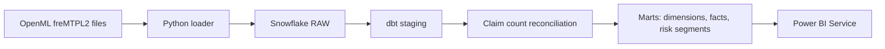
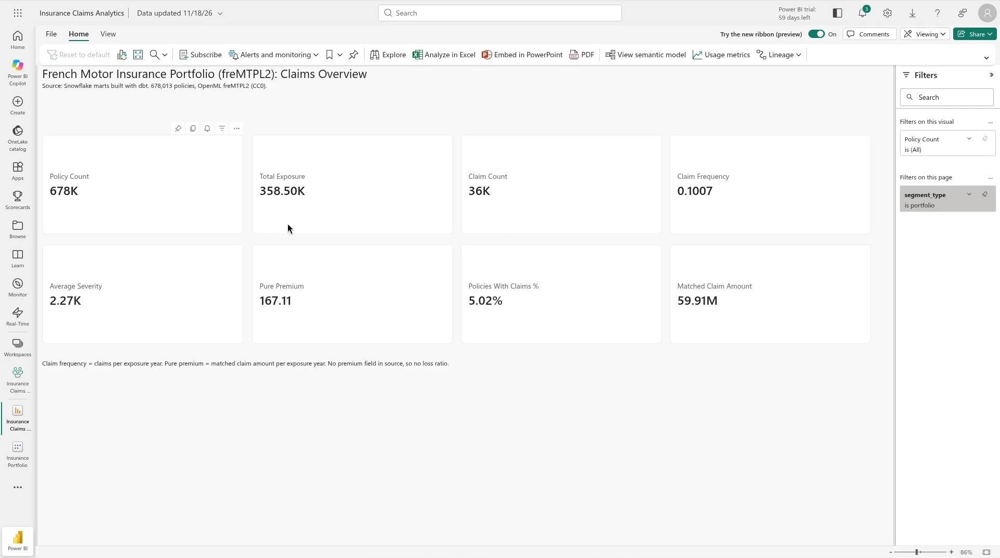
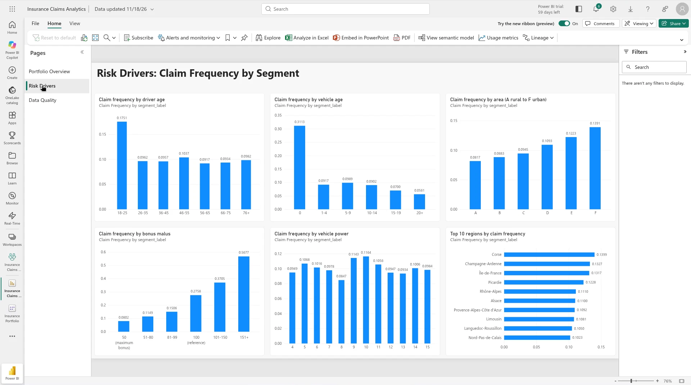
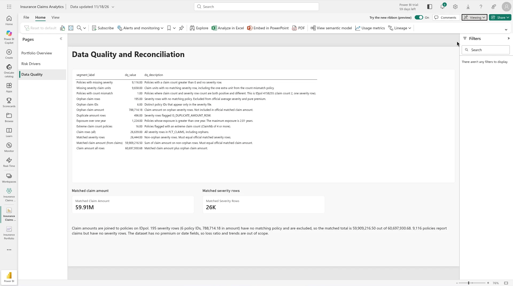

# Insurance claims analytics with Snowflake, dbt, and Power BI

This project shows how I would support a reporting migration like the one at HDI Global Insurance. Raw policy and claims data lands in Snowflake in a shape that looks like extracts from a Guidewire style policy system and claims system. dbt then stages, tests, and models that data into a star schema. A Power BI Service report is the reporting layer that would replace a legacy Qlik dashboard.

The source is not a live Guidewire extract. It is the public French MTPL book freMTPL2, used here as a stand in for policy and claims feeds. There is no premium column in the files, so this project does not compute a loss ratio and does not invent one.

The figures below come from the full book, which I profiled in Python, loaded into Snowflake, and checked with dbt tests. GitHub Actions uses a smaller committed sample so the workflow can run without storing the full extracts in the repo.

## Architecture



The raw layer splits the flat frequency file into `POLICIES`, `VEHICLES`, and `DRIVERS`, and lands each severity row in `CLAIMS`. Surrogate keys and a claim sequence are the only business derivations in that step. dbt adds type cleanup, quality flags, documented age and bonus malus bands, and the measures used for reporting: claim frequency, average severity, and pure premium.

A local DuckDB target mirrors the same models so the project can run without a Snowflake login. The Snowflake prod profile reads account settings from environment variables and never stores a password in the repo.

## Data source and license

The data is `freMTPL2freq` ([OpenML 41214](https://www.openml.org/d/41214)) and `freMTPL2sev` ([OpenML 41215](https://www.openml.org/d/41215)), published under a [CC0](https://creativecommons.org/publicdomain/zero/1.0/) license by Christophe Dutang and Arthur Charpentier in [CASdatasets](https://dutangc.github.io/CASdatasets/reference/freMTPL.html).

The files describe motor third party liability policies, observed mostly over one year, in a period of approximately 2011 to 2013. The parquet I downloaded has 678,013 policies, which is 22 more than the 677,991 often cited in documentation. I kept the downloaded files intact and documented the gap. Severity has 26,639 rows, of which 26,444 match a policy in the frequency file.

## Key results

These totals were computed from the full files and then reconciled in DuckDB and in Snowflake (`INSURANCE_PORTFOLIO.MARTS`).

| Metric | Value |
| --- | --- |
| Policies | 678,013 |
| Total exposure | 358,499.45 policy years |
| Total claims (`sum(ClaimNb)`) | 36,102 |
| Policies with at least one claim | 34,060 (5.02%) |
| Claim frequency (`ClaimNb` / exposure) | 0.100703 |
| Matched claim amount | 59,909,216.50 |
| Average severity, matched claims | 2,265.51 |
| Median severity, all claim rows | 1,172.00 |
| Pure premium, matched amount / exposure | 167.11 |

Claim frequency is `sum(ClaimNb) / sum(Exposure)`. Average severity is the mean of matched `ClaimAmount` values. Pure premium is matched claim amount divided by exposure. Frequency based on severity rows is lower (0.073763) because 9,657 claim counts in the policy file have no amount row. Official reporting keeps frequency on `ClaimNb` and uses matched amounts for severity and pure premium.

A few segment results from the same run:

- Drivers aged 18 to 25 have the highest frequency (0.175069) and the highest average severity (5,121.62).
- Frequency rises from rural Area A (0.081702) to urban Area F (0.139127).
- New vehicles (`VehAge = 0`) show a very high `ClaimNb` frequency (0.311322), but only 1,181 matched severity rows against 5,205 claim counts. That band is not comparable without the quality caveat below.

## Data quality

The raw layer keeps source issues instead of silently fixing them. dbt tests document the ones that should stay stable on the full book.

- 9,116 policies have `ClaimNb` greater than 0 and no severity row. Those policies account for 9,657 missing claim amounts. 3,815 of them are new vehicles.
- One policy (IDpol 4,158,255) has `ClaimNb` of 2 and only one severity row.
- Six policy IDs appear only in the severity file: 195 claim rows and 788,714.18 of amount, with no exposure to put in the denominator. The dbt relationship tests on those claims are set to warn.
- 1,224 policies have exposure greater than one year, up to 2.01 years.
- Claim amounts cluster at 1,204.00, 1,128.12, and 1,172.00, which is consistent with documented IRSA-IDA convention amounts. The files do not label which rows those are.
- `IDpol` and `Density` arrive as floats and are integer valued. Raw tables store them as integers.

## How to run locally with DuckDB

The repo ships a 5,000 policy sample in `data/sample`. That is enough to run the loader, dbt, and the sample reconciliation.

```bash
python -m venv .venv
source .venv/bin/activate
pip install -r requirements.txt
python scripts/load_raw.py --target duckdb --data-dir data/sample
cd dbt
dbt deps --profiles-dir .
dbt build --profiles-dir . --target dev --vars 'book_scope: sample'
cd ..
python scripts/verify_marts.py --scope sample
```

To work with the full book, download the OpenML parquet files and omit the sample var so the full book tests run:

```bash
python scripts/download_raw.py
python scripts/load_raw.py --target duckdb --data-dir data/raw
cd dbt
dbt deps --profiles-dir .
dbt build --profiles-dir . --target dev
cd ..
python scripts/verify_marts.py --scope full
```

GitHub Actions follows the sample path on every push and pull request.

## How to run on Snowflake

Create a database such as `INSURANCE_PORTFOLIO`, with `RAW` and `ANALYTICS` schemas, and a warehouse of the smallest size, set to pause after a short idle time. Put account settings in environment variables. Do not put a password in the repo, in a committed `.env` file, or in the chat history if you can avoid it.

Required variables:

- `SNOWFLAKE_ACCOUNT`
- `SNOWFLAKE_USER`
- `SNOWFLAKE_PASSWORD`
- `SNOWFLAKE_DATABASE`
- `SNOWFLAKE_WAREHOUSE`
- `SNOWFLAKE_SCHEMA`

Optional: `SNOWFLAKE_RAW_SCHEMA` (defaults to `RAW`) and `SNOWFLAKE_ROLE`.

```bash
pip install -r requirements-snowflake.txt
python scripts/download_raw.py
python scripts/load_raw.py --target snowflake --data-dir data/raw
cd dbt
dbt deps --profiles-dir .
dbt build --profiles-dir . --target prod
```

dbt writes staging, intermediate, marts, and seeds into their own schemas. Power BI should read from the `MARTS` schema: `DIM_POLICY`, `DIM_VEHICLE`, `DIM_DRIVER`, `FCT_POLICY_EXPOSURE`, `FCT_CLAIMS`, and `MART_RISK_SEGMENTS`. The `ANALYTICS` schema is the dbt target schema and may be empty. The Power BI Service report uses a `segments` table exported from those marts. Measure definitions are in `docs/power_bi_design.md`.

## Power BI report

I built the report in Power BI Service (the browser app) on a semantic model named Insurance Portfolio. The model uses one long format table called `segments`. The table has 75 rows: the book total, risk segments (driver age, vehicle age, area, region, vehicle power, bonus malus, and fuel), and 13 data quality checks.

`scripts/build_powerbi_excel.py` exports the Snowflake `MARTS` tables, through the `INSURANCE_PBI_READONLY` role, to an Excel workbook. That workbook is gitignored because it is large, and importing it in Power BI Service failed on this Pro trial capacity with `CapacityDoesNotSupportPremiumFilesException`. The path that worked was `scripts/build_pbi_paste_table.py`, which aggregates the same marts into `powerbi/service/pbi_paste_table.tsv`. I pasted that file into Power BI Service with Enter data. The measures below are only valid when a visual is filtered to one `segment_type`. An unfiltered sum would count the book more than once.

The ten DAX measures in the model are Policy Count, Total Exposure, Claim Count, Claim Frequency, Matched Claim Amount, Matched Severity Rows, Average Severity, Pure Premium, Policies With Claims, and Policies With Claims %. There is no Loss Ratio measure, because the source has no premium. Total Exposure is the sum of exposure years. It is named that way because the table already has an exposure column.

The report has three pages. Some cards use Power BI's compact display (678K, 358.50K, 59.91M), which matches the book totals in the results table above.

1. Portfolio Overview, with eight cards filtered to the book: 678,013 policies, 358,499.45 years of exposure, 36,102 claims, a claim frequency of 0.100703, average severity of 2,265.51, pure premium of 167.11, 5.02% of policies with a claim, and 59,909,216.50 of matched claim amount.



Portfolio Overview in Power BI Service. The cards are filtered to `segment_type` = portfolio.

2. Risk Drivers, with claim frequency by driver age, vehicle age, area, bonus malus, vehicle power, and the top 10 regions. Drivers aged 18 to 25 have a frequency of 0.175069. Frequency rises from 0.081702 in rural Area A to 0.139127 in urban Area F. New vehicles (vehicle age 0) show 0.311322, and the 151+ bonus malus band reaches 0.567655. Corse is the highest frequency region, at 0.139869.



Risk Drivers. Each chart is filtered to one `segment_type` so the frequencies are not mixed across segments.

3. Data Quality and Reconciliation, with the 13 quality checks, cards for Matched Claim Amount (59,909,216.50) and Matched Severity Rows (26,444), and a short reconciliation note. Official average severity and pure premium exclude 195 orphan severity rows (6 policy IDs, 788,714.18 of amount) that have no matching policy.



Data Quality and Reconciliation. Source issues stay visible instead of being cleaned away.

If you prefer Power BI Desktop, the project in `powerbi/` connects to the same Snowflake marts. Open `powerbi/InsurancePortfolio.pbip`, enter your Snowflake username and password when Desktop prompts you, and refresh. The files have no credentials. A packed copy is at `powerbi/InsurancePortfolio-PBIP.zip`. Spanish step by step instructions are in `docs/powerbi_abrir_es.md`. The totals to check after refresh are in `docs/powerbi_expected_numbers.md`.

## Project layout

- `scripts/download_raw.py` fetches the full OpenML parquet files into `data/raw`.
- `scripts/build_sample.py` rebuilds the committed sample from those files.
- `scripts/load_raw.py` builds the raw tables in DuckDB or Snowflake.
- `notebooks/01_profile.py` and `docs/data_profile.md` hold the full book profile.
- `dbt/` is the dbt project, with tests that lock the full book totals when `book_scope` is `full`.
- `sql/snowflake/` has the Snowflake DDL and a `COPY INTO` template.
- `scripts/build_powerbi_excel.py` exports Snowflake marts to a gitignored Excel workbook.
- `scripts/build_pbi_paste_table.py` builds the 75 row `segments` table used in Power BI Service.
- `powerbi/service/` has the paste file, build notes, and small extracts. The Excel workbooks stay gitignored.
- `docs/power_bi_design.md` describes the star schema and DAX measures.
- `docs/powerbi_abrir_es.md` is the Spanish guide for opening the Desktop project.
- `docs/powerbi_expected_numbers.md` is the checklist of book totals to confirm after refresh.
- `docs/images/` has screenshots of the three Power BI Service report pages.
- `powerbi/` is the Power BI Project (PBIP) with the TMDL semantic model and a three page report for Desktop.

The code in this repository is under the MIT license. The source data remains CC0, with credit to Dutang and Charpentier.

## About me

I am Camilo Gualteros, a data analyst with more than four years of experience. I have been a contract Data Analyst in Model Evaluation at Mercor since May 2026. Before that I was a Data Analyst in Analytics and Machine Learning at Stee Holdings, from June 2022 to May 2026. I work with Snowflake, dbt, SQL, Python, Tableau, Power BI, and Salesforce.

LinkedIn: [https://www.linkedin.com/in/camilo-gualteros-00806a338](https://www.linkedin.com/in/camilo-gualteros-00806a338)
